# NEXUS OS

Your personal AI operating system. One intelligent workspace that understands your life, remembers your context, plans your work and executes tasks.

**[Open the live demo](https://aqkprogrammer.github.io/nexus-os/)**

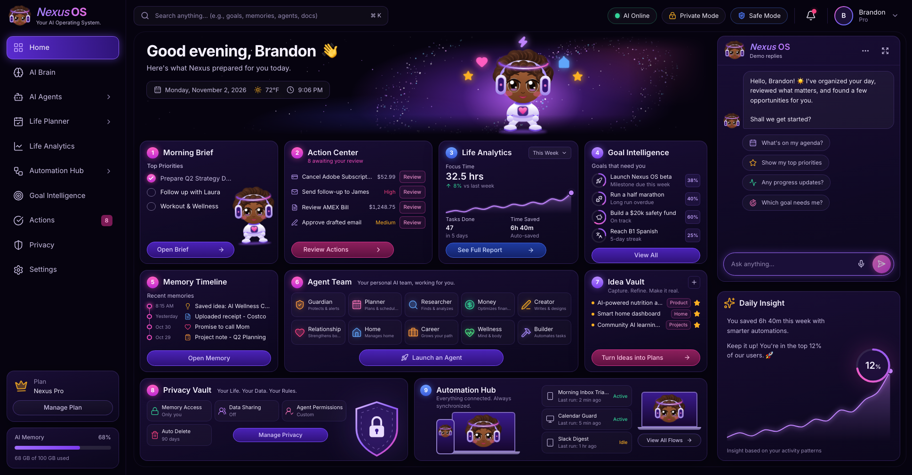

This repository is the full app: accounts, a Postgres database, AI chat and agents, email, push notifications, Google Calendar and Gmail, Stripe billing and shared spaces. Each outside service is optional. Without its key, the feature says it isn't set up rather than failing.

The GitHub Pages demo has no server, so it has no login, keeps data in your browser and uses built-in demo replies.

## Screenshots

| AI Brain | AI Agents |
| --- | --- |
| 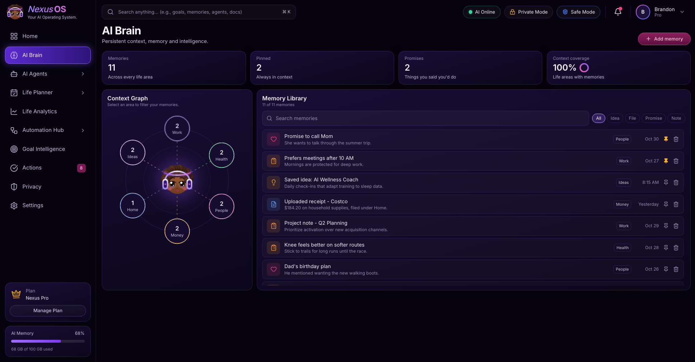 | 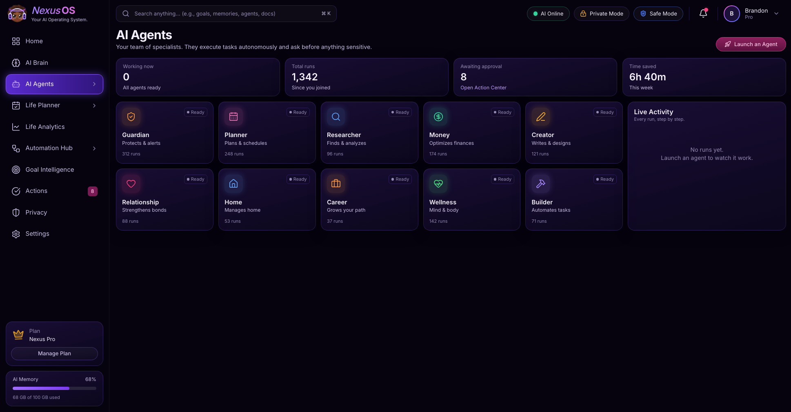 |

| Life Planner | Life Analytics |
| --- | --- |
| 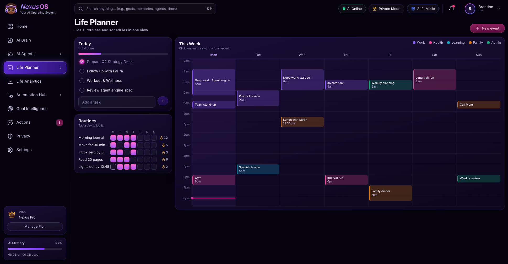 | 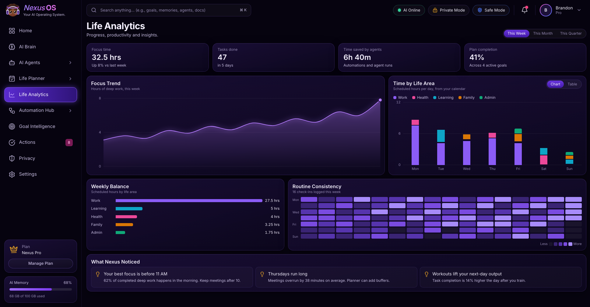 |

| Automation Hub | Goal Intelligence |
| --- | --- |
| 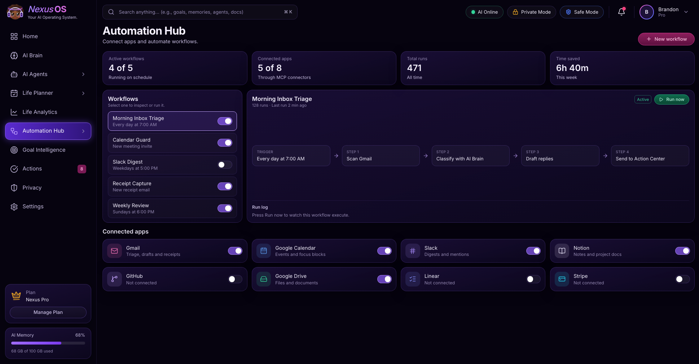 | 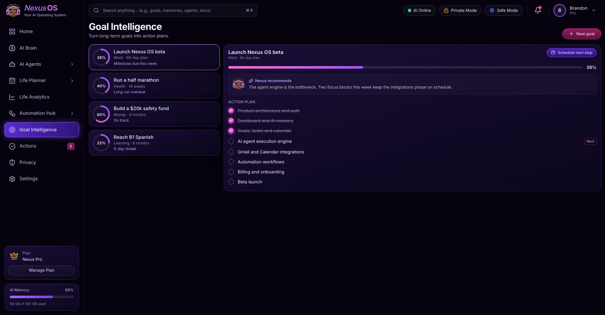 |

| Actions | Privacy Vault |
| --- | --- |
| 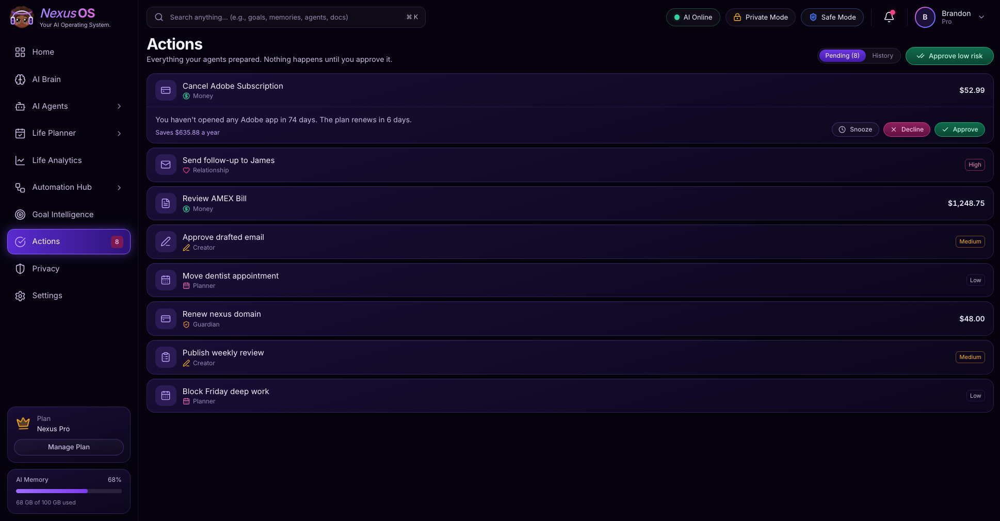 | 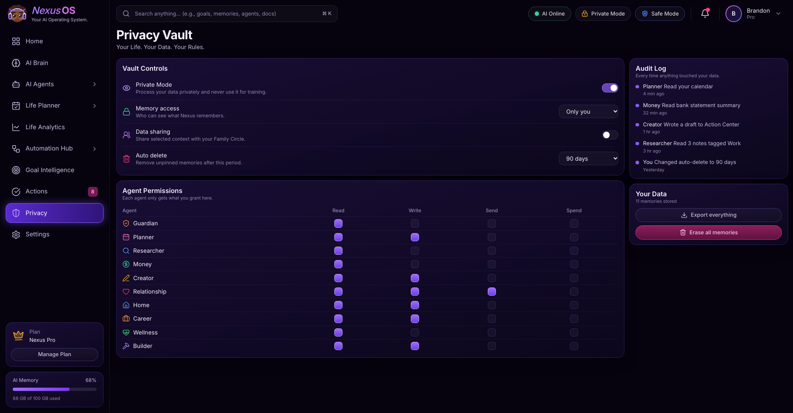 |

| Settings | Mobile |
| --- | --- |
| 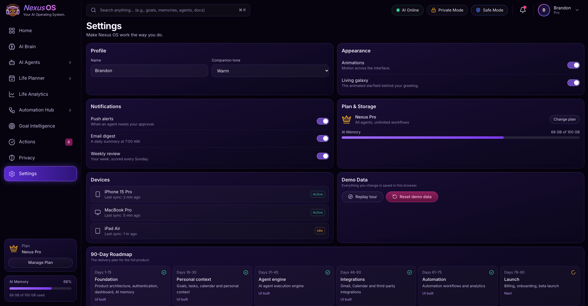 | 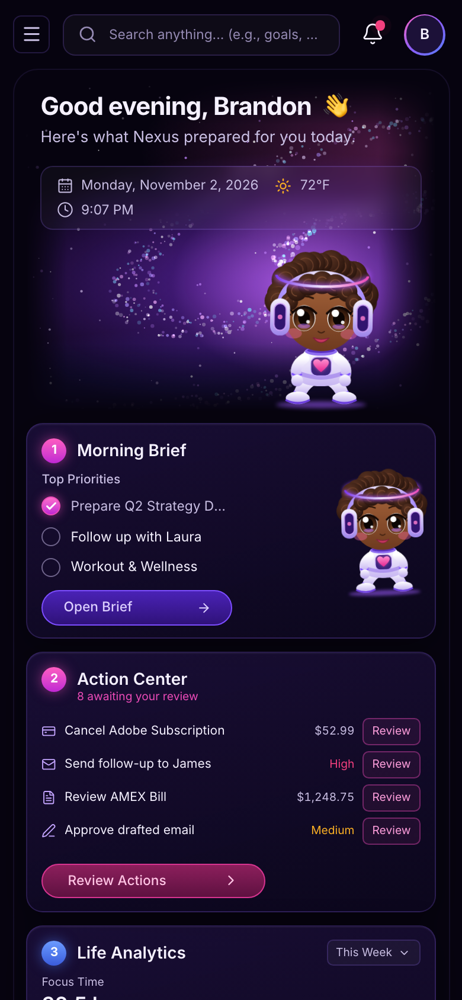 |

## Run it

You need Node.js and a running Postgres server with the [pgvector](https://github.com/pgvector/pgvector) extension. On a Mac with Homebrew:

```bash
brew install pgvector
```

1. Install the packages and copy the settings template:

   ```bash
   npm install
   ```

   ```bash
   cp .env.example .env.local
   ```

2. Fill in `DATABASE_URL`, `BETTER_AUTH_SECRET` and `ALLOWED_EMAILS` in `.env.local`. The rest of the file is optional, one block per feature.

3. Create the database and its tables:

   ```bash
   createdb nexus_os
   ```

   ```bash
   npm run db:deploy
   ```

4. Start the app:

   ```bash
   npm run dev
   ```

Then open http://localhost:3000 and create an account with an email from `ALLOWED_EMAILS`.

| Script | Purpose |
| --- | --- |
| `npm run dev` | Development server |
| `npm run build` | Production build |
| `npm start` | Run the production build |
| `npm run typecheck` | TypeScript check |
| `npm test` | Browser tests with Playwright |
| `npm run db:migrate` | Create a migration after changing `prisma/schema.prisma` |
| `npm run db:deploy` | Apply migrations to a database |

## Testing

`npm test` builds the app and drives it in a real browser, covering the main flows on desktop and every page at phone size. Each test signs in to a fresh account. Every outside service runs against a stand-in in `e2e/mock-openai.mjs`: OpenAI, Resend, Stripe, Google and a push service. Tests are free and need no keys. Local runs use your installed Chrome.

The tests need a separate database, which they migrate themselves:

```bash
createdb nexus_os_test
```

They connect as your system user. Set `TEST_DATABASE_URL` to use a different connection.

Every push to `main` runs the same tests, and a failure stops the deploy.

## Accounts and data

Sign-in uses email and password through [Better Auth](https://www.better-auth.com). Passwords are hashed, and repeated attempts are rate limited by visitor address. Behind a proxy other than Vercel's, set `AUTH_IP_HEADER` to the header it sets, so the limit can't be dodged with a fake address.

- **Sign-up is invite-only.** Only emails in `ALLOWED_EMAILS` can create an account, so a public deployment can't be used to spend your OpenAI credit.
- **Each account has its own workspace.** It is saved to Postgres shortly after every change, and nothing personal stays in the browser.
- **New accounts start empty.** Every figure comes from the account's own data, and nothing invented, like the sample's weather, rankings or history, is shown. Settings can load the sample data to explore, or clear the workspace again.
- **Two open tabs can't silently overwrite each other.** A save from an out-of-date tab is refused, and that tab reloads the newer workspace and says so.
- **Activity is dated.** Finished tasks, approvals, routine check-ins and agent runs are recorded, so Life Analytics shows real weeks, months and quarters.
- **Settings has full account control.** Change your email or password, see and sign out other devices, export everything, or delete the account.
- **Password reset and email confirmation** work once email is set up.

The API routes check the session on every request. `src/proxy.ts` only redirects signed-out visitors, so it is not what protects the data.

## AI

Add your key to `OPENAI_API_KEY` in `.env.local`, then restart `npm run dev`. That turns on:

- **Chat.** Replies stream from OpenAI, use your workspace and memories that match the question, and can add tasks, save memories, schedule events, create goals and launch agents.
- **Agents.** An agent does the task and leaves the actual result, a draft, plan or list, in Action Center for your approval.
- **Goal plans.** New goals get milestones written for that goal and your calendar.
- **Quick capture.** Press C anywhere to jot a note. AI sorts it into a task, memory, event or idea.
- **File reading.** Receipts, PDFs and images uploaded to AI Brain become memories of what's in them.
- **Memory search.** AI Brain finds memories by meaning, using pgvector.

Without a key, each of these says so and falls back: demo chat replies, agent previews, a starting goal template, simple sorting rules and word search.

**Privacy:** AI requests send the parts of your workspace they need to OpenAI, including tasks, calendar, goals and memories, with `store: false`. Text that came from other people, like email subjects, is marked as data so the model doesn't follow instructions inside it.

**Cost control:** every AI request needs a signed-in user, is rate limited per user and has capped sizes. With billing set up, each plan also has a daily AI allowance (`FREE_AI_DAILY`, `PRO_AI_DAILY`). Set a monthly spend limit in your OpenAI account before deploying.

## Other services

| Feature | Set up | Without it |
| --- | --- | --- |
| Password reset, email confirmation, invitations, daily and weekly summaries | `RESEND_API_KEY`, `EMAIL_FROM` and `CRON_SECRET`, with `/api/cron/digest` called every hour | Reset says email isn't set up, and invitations give a link to share |
| Push notifications and installing on a phone | A VAPID key pair from `npx web-push generate-vapid-keys` | The app still installs, and Settings says push isn't set up |
| Google Calendar and Gmail, read only | `GOOGLE_CLIENT_ID` and `GOOGLE_CLIENT_SECRET` | Automation Hub says Google isn't set up |
| Billing | `STRIPE_SECRET_KEY`, `STRIPE_PRICE_PRO` and `STRIPE_WEBHOOK_SECRET` | Everyone has unlimited use |

- **Summaries** go out at 7 AM in each person's time zone, and the weekly review on Sunday at 6 PM. They only go to confirmed email addresses, and Settings turns them off.
- **Gmail is a restricted scope.** Until Google verifies your app, up to 100 test users can connect it.
- **Push** only sends to the push services of Google, Mozilla, Apple and Microsoft, so the server can't be pointed at other addresses.
- **Uploads** are stored in Postgres, up to 4 MB each and 200 MB per account. Only images, PDFs and text files are accepted, and they always download as attachments.
- **Stripe** hosts the payment and billing pages, so card details never reach this server.

## Shared spaces

Create a space for family or a team, then invite people by email as editors or viewers. Everyone sees the same shared goals and calendar. Editors can change them, viewers can only look, and only the owner manages members. An invitation also lets that email create an account, even when it isn't in `ALLOWED_EMAILS`, so each person can send 20 new invitations a day, and the same address is emailed at most once every 10 minutes.

## Deployment

**Full app:** deploy to a Node host such as Vercel with a hosted Postgres database that has pgvector. Set the variables from `.env.example` in the host's settings, with `BETTER_AUTH_URL` set to the deployed address, and run `npm run db:deploy` against that database. `vercel.json` runs the summary job every hour, which needs a Vercel plan that allows hourly crons. Never commit secrets.

**Demo:** every push to `main` runs `.github/workflows/deploy.yml`, which tests the app, then publishes a static build to GitHub Pages. Setting `PAGES_BASE_PATH` selects that build and leaves out the API and login. Setting `SITE_URL` makes the link preview image use a full URL.

## Modules

| Route | Module | What works today |
| --- | --- | --- |
| `/` | Home | The nine-card dashboard, real AI companion chat and daily insight |
| `/brain` | AI Brain | Context graph, search by meaning, file uploads, pin, add, delete |
| `/agents` | AI Agents | Ten agents that do real work with AI, live step-by-step runs |
| `/planner` | Life Planner | Repeating tasks, week calendar with Google events and reminders, routines |
| `/analytics` | Life Analytics | Weeks, months and quarters from dated activity, heatmap, table view |
| `/automations` | Automation Hub | Workflow runner, flow diagram, Google connection, templates |
| `/goals` | Goal Intelligence | AI-written plans, milestones, scheduling into today |
| `/spaces` | Shared Spaces | Shared goals and calendar, invitations, editor and viewer roles |
| `/actions` | Actions | Approve, decline, snooze, bulk approve, history |
| `/privacy` | Privacy Vault | Vault controls, permission matrix, full export, erase |
| `/settings` | Settings | Profile, account, devices, push, plan and billing, roadmap |

## Project layout

```
src/app/(app)/         One folder per module route
src/components/shell/  Sidebar, topbar, command palette, global modals
src/components/dashboard/  Dashboard cards, companion chat
src/components/ui.tsx  Cards, buttons, toggles, modals, toasts
src/components/charts.tsx  Area, stacked bar and heatmap charts
src/components/Mascot.tsx  Animated SVG mascot
src/lib/data.ts        Types and seed data
src/lib/store.ts       App state
src/lib/workspace-sync.ts  Loads and saves the workspace through the API
src/lib/auth.ts        Better Auth setup and the sign-up invite list
src/lib/db.ts          Prisma client
src/lib/companion.ts   Demo replies used when no model is available
src/lib/chat-*.ts      Chat client, workspace context and tool definitions
src/lib/ai.ts          Shared rules and structured requests for every AI endpoint
src/lib/activity.ts    Dated activity and the week and day helpers analytics uses
src/app/api/           Chat, workspace, agents, plans, capture, memory search, uploads,
                       account, push, Google, billing, shared spaces and the summary job
src/app/login/         Sign in and create account
src/app/reset-password/  Password reset
public/                App manifest, icons and the service worker for push
prisma/                Database schema and migrations
```

## Connecting the backend

Most of the product is real now. What's still simulated is in one place each, so it can be swapped without touching the screens.

| Replace | With |
| --- | --- |
| `runWorkflow` in `src/lib/store.ts` | Redis queues that run workflows on a schedule |
| Apps other than Google in Automation Hub | MCP connectors |
| `launchAgent` in `src/lib/store.ts` | The LangGraph engine, for agents that take more than one step |

| Layer | Technology |
| --- | --- |
| Frontend | Next.js 16, TypeScript |
| UI | Tailwind CSS |
| Backend | FastAPI + Node.js |
| Database | PostgreSQL + pgvector |
| ORM | Prisma / SQLAlchemy |
| Cache | Redis |
| AI | OpenAI models |
| Agents | LangGraph |
| Integrations | MCP |
| Background jobs | Redis queues |
| Infrastructure | Docker + AWS |

## 90-day roadmap

| Timeline | Deliverables |
| --- | --- |
| Days 1-15 | Product architecture, authentication, dashboard, AI memory |
| Days 16-30 | Goals, tasks, calendar and personal context |
| Days 31-45 | AI agent execution engine |
| Days 46-60 | Gmail, Calendar and third-party integrations |
| Days 61-75 | Automation workflows and analytics |
| Days 76-90 | Billing, onboarding, beta launch |
